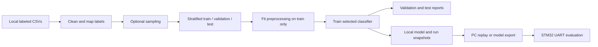

# Architecture and dashboard API

[Documentation index](README.md) · [Command reference](commands.md)

## Training data flow



The main application uses 15 float features and five classes. The PC performs network capture and flow construction. The supplied STM32 adapter receives feature rows over UART and predicts; it does not implement Ethernet capture or flow construction on the microcontroller.

## Module responsibilities

| Module or directory | Responsibility |
|---|---|
| `src/config.py` | Load a complete config, enforce canonical feature order, resolve model/scaler/run split paths |
| `src/data/loader.py` | Discover direct CSV children and read/concatenate cleaned chunks |
| `src/data/cleaner.py` | Trim columns, convert numbers, drop nonfinite values and unsupported labels |
| `src/data/label_map.py` | Five-class label taxonomy and target report order |
| `src/data/split.py` | Two-stage stratified split and dataframe-relative index lists |
| `src/data/replay.py` | SHA-256 manifests, saved-config reconstruction and split selection |
| `src/features/feature_list.py` | Exact ordered 15-feature contract |
| `src/features/preprocess.py` | Train-fitted log1p selection and MinMax transform serialization |
| `src/model/architecture.py` | Random Forest/Logistic Regression factories and string-label XGBoost wrapper |
| `src/model/train.py` | Balanced class weights and backend fitting |
| `src/model/evaluate.py` | Probability-column alignment, accuracy/F1, per-class reports and plots |
| `src/model/export.py` | joblib persistence and timestamped metadata |
| `src/flows.py` | Shared bidirectional IPv4 flow counters and expiry for Scapy commands |
| `src/uart/protocol.py` | Row serialization and CSV/JSON reply parsing |
| `src/uart/evaluate.py` | Shared device inference loop, accepted indices and report provenance |
| `src/dashboard/` | Flask endpoints, in-memory event storage and frontend |
| `src/main_*.py` | CLI orchestration; see the command reference for every entry point |
| `firmware/` | HAL adapter source and integration guidance |
| `tests/` | Generated-fixture software, flow, UART, reporting and host C checks |
| `tools/check_publication.py` | Local-only file/history exclusion check and Kaggle token pattern check |

## Preprocessing and model contracts

For each eligible nonnegative training feature, log1p is selected when skew exceeds `features.log1p_skew_threshold`. Min/max values are fitted after those transformations. For each feature, inference applies its saved transform and computes `(value - min) / (max - min)`; a constant feature uses denominator 1. Outputs are float32.

Scaling does not clip unseen inputs into `[0,1]`. A negative value passed to a log-selected feature can produce invalid output. Preprocessor parameters, feature order and model must always come from the same run.

Random Forest and Logistic Regression use balanced class weights; XGBoost receives corresponding per-row weights. Numeric class IDs are a separate deployment contract. Use model/export metadata instead of assuming the five classes always have the same numeric ordering across backends.

The plain-C export writes tree arrays, retains double branch thresholds, and uses float leaf probabilities. It also generates `rf_preprocessor.h` from the selected run, so firmware does not embed preprocessing constants from an unrelated experiment. Host tests check representative prediction/preprocessing agreement, including threshold-adjacent inputs. Actual board numerical behavior, size and timing still require device measurements.

## Artifact ownership

Each named run spans models, scalers, reports and metadata directories. Configs, fingerprints and split lists belong to the run. The raw data belongs to a separately managed local dataset. Split integers alone are insufficient to identify the original raw rows.

Unversioned latest copies are convenience outputs. They are overwritten during training and are shared across algorithms using the same artifact roots. Use named runs and sequential jobs. Generated files are not committed to Git.

## Dashboard API

Start with `python -m src.main_serve`; the default base URL is `http://127.0.0.1:5000`. This server is a local demonstration, with no authentication or persistent event database.

| Method and route | Request | Response |
|---|---|---|
| `GET /` | None | Dashboard HTML |
| `POST /api/events` | One JSON event object or a list of event objects | `{"status":"ok","count":N}` |
| `GET /api/events` | Optional `limit`, `class`, `min_confidence` query parameters | `{"events":[...]}` sorted by timestamp descending |
| `GET /api/stats` | None | `{"total":N,"by_class":{...}}` |

An example prediction event:

```json
{
  "ts": "2026-01-01T12:00:00+00:00",
  "flow_id": "example_flow_1",
  "predicted_class": "Normal",
  "confidence": 0.85,
  "top_feature_values": {"Tot Fwd Pkts": 8.0},
  "scaled_feature_preview": [0.1, 0.2, 0.3]
}
```

This is an illustrative schema, not a dataset row. A missing timestamp is filled with the server's current UTC time. UART replay can also attach `ground_truth`, `source: stm32_uart`, and a raw/scaled feature preview. Not all producers supply every optional field; the table can therefore show an empty feature summary for UART events.

PowerShell example, after starting the server:

```powershell
$event = @{flow_id='example_flow_1'; predicted_class='Normal'; confidence=0.85} | ConvertTo-Json
Invoke-RestMethod -Method Post -Uri http://127.0.0.1:5000/api/events -ContentType application/json -Body $event
Invoke-RestMethod 'http://127.0.0.1:5000/api/events?limit=10&class=Normal&min_confidence=0.5'
Invoke-RestMethod http://127.0.0.1:5000/api/stats
```

Restarting the server clears all events. Counts include received predictions from every producer/replay in that server process; they are not an independently measured attack rate. The store is unbounded in memory, so keep demonstrations bounded. Keep the default local bind and use trusted event producers; this is not a production API.

## Device report provenance

UART evaluators retain exact row indices for successful replies, including gaps caused by timeouts or rejected responses. Hard-prediction metrics use those accepted rows. PC probability curves select the same accepted rows and are marked `probability_source: pc_joblib_reference`; they are not read from the board.

Device confidence may come from a model probability or a placeholder, depending on firmware. The default plain-C adapter reports the selected probability; the optional emlearn example reports fixed confidence. Neither is a calibrated real-world certainty estimate.
